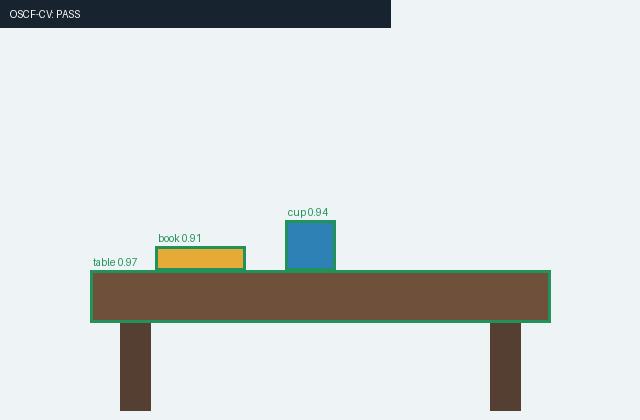
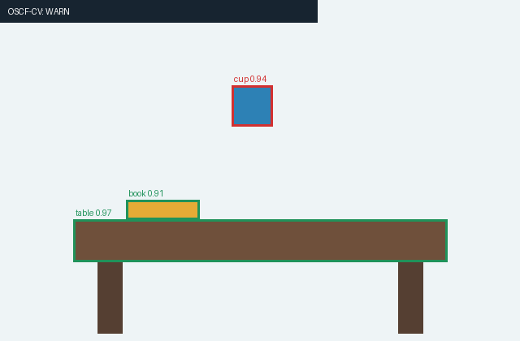

# OSCF-CV MVP · Octonion-based Spatial Consistency Field

A **research prototype** for comparing octonion associator features with simple, declared, 2-D scene constraints on photos. Runs with **numpy + Pillow** (no GPU / model weights for the demo), or optionally takes outputs from **Ultralytics YOLO and SAM2**.

**Not** a validated physical-causality detector. A nonzero octonion associator is not a defect. No model confidence is treated as a calibrated probability of physical existence. No depth or surface normal is fabricated from one RGB image.

## Visual Demo

| Constraint satisfied | Constraint violated |
|:---:|:---:|
|  |  |
| PASS — cup on table | WARN — declared support relation violated |

*Deterministic synthetic scenes with predefined object boxes.
Not real-model inference results.*

## 1. Run the reproducible demo

```bash
python -m pip install -r requirements.txt
python oscf_cv_mvp.py --demo --out outputs
python -m unittest discover -s tests -v
```

The demo constructs two **synthetic** RGB images, with identical class predictions and confidence values. A manually declared `cup:on:table` relation is satisfied in one image and violated in the other. Outputs include:

- `outputs/demo_supported_input.png`, `outputs/demo_floating_input.png`
- `outputs/demo_supported_annotated.png`, `outputs/demo_floating_annotated.png`
- `outputs/demo_supported_audit.json`, `outputs/demo_floating_audit.json`

The rule checks *2-D alignment* only. The `octonion_features` compare the actual encoded scene to a simple **geometric projection counterfactual** that moves the cup onto the table. They are research signals, **not independent proof of a causal relation**.

## 2. Use YOLO on your picture

```bash
python -m pip install ultralytics
python oscf_cv_mvp.py --image your_photo.jpg --out outputs
```

By default, uses `yolo26n.pt` (check your installed Ultralytics version and available checkpoint); on first use the package may download weights. You can provide other weights, for example `--yolo-model yolo11n.pt`. Model outputs become normalized 8-component codes. **No spatial rule is asserted** unless you declare one, so the result says `UNCONSTRAINED` by default.

To explicitly test a declared relationship on an appropriate picture:

```bash
python oscf_cv_mvp.py --image photo.jpg --yolo-model yolo26n.pt --on cup:table
```

The rule `cup:table` means **"the cup is expected to rest on this table in this scene"**. Do not apply it indiscriminately to all images containing cups.

## 3. YOLO + SAM2 segmentation

```bash
python oscf_cv_mvp.py --image photo.jpg --sam-model sam2.1_t.pt --on cup:table
```

YOLO supplies object label, bounding box and classification score; the optional SAM2 model segments **one YOLO-prompted box at a time** so mask ordering is unambiguous. Mask area and orientation proxy replace the box-only proxies in the 8D encoding. SAM mask confidence is not substituted for YOLO detection confidence.

**Implementation references:**

- Ultralytics YOLO prediction results: https://docs.ultralytics.com/modes/predict/
- Ultralytics SAM2 box-prompt inference: https://docs.ultralytics.com/models/sam-2/

Integration is implemented against these documented APIs but **has not been executed against downloaded model weights in this environment**. Test it on your installed model version.

## 4. Use external detections (no YOLO download)

Given an existing picture and a JSON file:

```json
{
  "objects": [
    {"id": "cup0", "label": "cup", "confidence": 0.94, "bbox": [285, 220, 335, 270]},
    {"id": "table0", "label": "table", "confidence": 0.97, "bbox": [90, 270, 550, 322]},
    {"id": "book0", "label": "book", "confidence": 0.91, "bbox": [155, 246, 245, 270]}
  ]
}
```

```bash
python oscf_cv_mvp.py --image scene.png --detections-json boxes.json --on cup:table
```

You may also provide `--depth-npy depth.npy`, where the supplied **registered H×W depth proxy** is already normalized to [0,1]. This code will not infer metric depth or unknown absolute scale from bounding boxes.

**Python:** 3.10+

**License:** Apache License 2.0.

**Optional dependencies:** Ultralytics for YOLO / SAM2 inference.
Check third-party model and dependency licenses
before redistribution or commercial deployment.

## 5. Exactly what is the octonion?

The Cayley-Dickson multiplication implements an **actual nonassociative octonion algebra**, not just an eight-number vector. For each entity:

`[r, e1, e2, e3, e4, e5, e6, e7]` =

`[confidence, center_x, center_y, depth_or_0, sqrt(area_fraction), 2D_orientation_proxy_or_0, semantic_policy_weight, proximity_coupling]`.

A `depth_valid` flag and `axis_proxy_valid` flag retain missing-information semantics. Names, IDs, bounding boxes, and masks are metadata, not implicitly encoded into eight scalar slots. Coordinates and areas are normalized. The eighth channel is a proximity proxy; it is not a learned or physically validated coupling coefficient.

For three **distinct** entities, the standard associator is:

`A(a,b,c) = (a*b)*c - a*(b*c)`.

To connect this algebra to a **specific declared rule**, the prototype records `||A(observed) - A(projected)||` (with normalization), as well as a **linear 8D displacement baseline**. The rule itself decides WARN/PASS; the associator is auxiliary telemetry. Fewer than 3 objects results in an `INSUFFICIENT` associator result, not a fake zero.

The same q data may be cached between frames using `TemporalCache`; the MVP does **not** use `q(t+1)=u(t)*q(t)` to update confidences and positions, because unconstrained left multiplication would not preserve their semantics.

## 6. The actual hypothesis to test

**H0:** Once ordinary 2D geometric/semantic and time-based features are included, octonion associator features add no predictive value.

**H1:** On held-out, adversarial, and intervention-labeled scenes, octonion features offer measurable additional detection/forecast signal at an acceptable false-positive rate.

Compare at least: geometry/scene-graph rules alone; linear 8D features; randomly permuted channels / randomized associators; octonion associator features + geometry. Report precision/recall, false alarm rate, calibration, and runtime. Do not label a held-out dataset or platform as "verified" until actually tested.

## 7. Planned next iteration

1. Real images with YOLO and SAM2 + expert-reviewed relational labels.
2. Video object ID tracking, temporal constraints and a state cache; optionally add depth/pose estimates.
3. Intervention/counterfactual dataset and strict ablations to see whether nonassociativity adds anything beyond baselines.
4. Only after those steps: set a deployment-specific risk threshold and consider blocking an action based on identified, reliable constraints.

## Collaboration Wanted

You are welcome to provide suggestions on real ID Switch videos, frame-by-frame detection boxes and trajectory IDs, and the tracker state update mechanism.

OSCF-Track is a planned research direction, not an existing feature at present.
